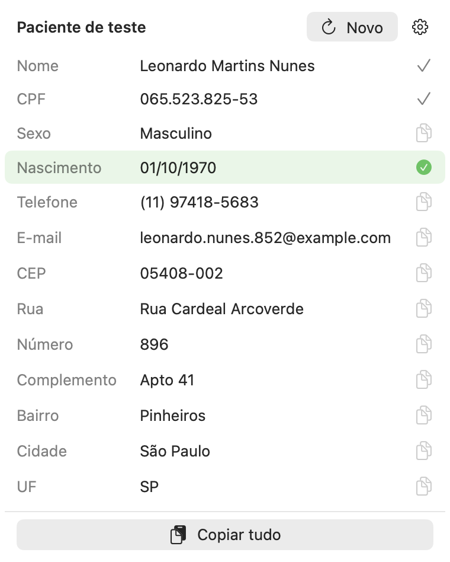

# CPF Fake

App de barra de menus para macOS que gera um paciente fictício (nome, CPF válido, nascimento, telefone, e-mail e endereço com CEP real) para cadastrar paciente de teste em sistemas de saúde.

O número é válido só na matemática e pode coincidir com o CPF de alguém real. Usar apenas em teste.

## Uso

Clique no ícone: abre um painel com um paciente novo. Cada clique numa linha copia aquele campo, e o painel continua aberto até você clicar no ícone de novo. Campos já copiados ficam marcados.

A engrenagem tem sexo (aleatório, feminino, masculino), pontuação do CPF, abrir ao iniciar o Mac e sair.

O e-mail usa `example.com`, reservado para teste. O telefone é aleatório e pode existir: não use em teste que dispare mensagem.

## Instalar

Baixe o `CPF-Fake.zip` da última release, descompacte e arraste para Aplicativos. O app é assinado e notarizado, então abre sem aviso.

## Compilar

- `./build.sh` compila o binário universal (arm64 e x86_64) e instala em `~/Applications`.
- `./release.sh` faz o mesmo, assina com Developer ID, notariza e gera `CPF-Fake.zip`. Precisa do certificado Developer ID Application no Keychain e de uma credencial `notary` salva com `xcrun notarytool store-credentials`.

`--prints <pasta>` salva o painel em PNG, claro e escuro.

Requer macOS 13 ou mais novo.
